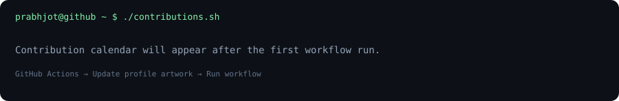

<table>
<tr>
<td width="42%" valign="top" align="center"></td>
<td width="58%" valign="top"></td>
</tr>
</table>

**Learn deeply. Build useful things. Contribute consistently.**

---

## `prabhjot@github:~$ whoami`

I'm **Prabhjot Singh**, a B.Tech Computer Science & Engineering student at **I.K. Gujral Punjab Technical University, India**. I enjoy building practical software, strengthening my fundamentals, exploring AI/ML, and learning how mature open-source projects are built and maintained.

- **Current direction:** C/C++, problem-solving, open source, and machine learning
- **Engineering habits:** debugging, testing, documentation, and thoughtful code reviews
- **Approach:** learn by building, understand before changing, and describe progress honestly

## `~/projects` — Selected work

<table>
<tr>
<td width="50%" valign="top">

### ♻️ [CivicBin AI](https://github.com/prabhtheone/CivicBin-AI)
An AI-assisted civic-cleanliness project exploring waste detection with computer vision.

Python · YOLO · Computer Vision · Civic Tech

</td>
<td width="50%" valign="top">

### 🤖 [FirstPR-AI](https://github.com/prabhtheone/FirstPR-AI)
A local-first assistant concept for helping open-source beginners understand issues, explore codebases, plan tests, and contribute safely.

Python · Gradio · Ollama · Developer Tools

</td>
</tr>
<tr>
<td width="50%" valign="top">

### 🏦 [Banking System in C](https://github.com/prabhtheone/banking-system)
A console-based banking simulation with account operations, validation, transaction history, and file persistence.

C · Structs · Functions · File I/O

</td>
<td width="50%" valign="top">

### 💳 [Ledger FinTech Demo](https://github.com/prabhtheone/ledger-fintech-demo)
A browser-based demo exploring wallets, transfers, budgeting, expense tracking, and rule-based fraud-check simulations.

JavaScript · React

</td>
</tr>
<tr>
<td width="50%" valign="top">

### 🌱 [Crop-AI](https://github.com/prabhtheone/Crop-AI)
An AI-focused project exploring technology for practical agricultural use cases.

</td>
<td width="50%" valign="top">

### 🌐 [Personal Portfolio](https://prabhtheone.vercel.app)
A home for my projects, interests, and development journey.

</td>
</tr>
</table>

<strong>More repositories and learning tracks</strong>

- [CCExtractor fork](https://github.com/prabhtheone/ccextractor) — learning a mature subtitle and closed-caption extraction codebase; [upstream project](https://github.com/CCExtractor/ccextractor).
- [OmniRoute](https://github.com/prabhtheone/OmniRoute) — exploring a unified interface for AI providers and coding tools.
- [Future AGI](https://github.com/prabhtheone/future-agi) — exploring evaluation and tracing tools for AI applications.
- [C programming practice](https://github.com/prabhtheone/programs-of-c) — a collection of C exercises (repository visibility may affect access).

## `~/open-source` — Learning in public

My current long-term open-source direction is **CCExtractor**. I’m learning the codebase, build and test workflow, debugging practices, and how to make focused, reviewable changes.

**Contribution loop:** Explore → Set up → Reproduce → Understand → Change → Test → Document → Request review.

I only describe work as merged or accepted when that has actually happened.

## `~/highlights`

**Top 5 — Let’s Start ’26: Zero to Prototype, NIT Jalandhar**

Placed among the Top 5 participants while working on CivicBin AI, an AI-assisted civic-cleanliness project concept.

[Event details](https://luma.com/ocvbp9p0) · [CivicBin AI](https://github.com/prabhtheone/CivicBin-AI)

## `~/toolbox`

These are technologies I’m learning or using in projects, not a claim of professional mastery.

## `~/learning`

- Strengthen C/C++ fundamentals, data structures, algorithms, and debugging.
- Build a deeper understanding of software design and testing.
- Contribute focused, well-tested changes to open-source projects.
- Keep learning AI/ML through practical projects and experimentation.

## `prabhjot@github:~$`

[Repositories](https://github.com/prabhtheone?tab=repositories) · [Recent activity](https://github.com/prabhtheone?tab=activity) · [LinkedIn](https://www.linkedin.com/in/prabhjot-singh-6aa788432) · [Portfolio](https://prabhtheone.vercel.app) · [Email](mailto:jotgill1522@gmail.com)

One codebase at a time. One issue at a time. Keep learning.
